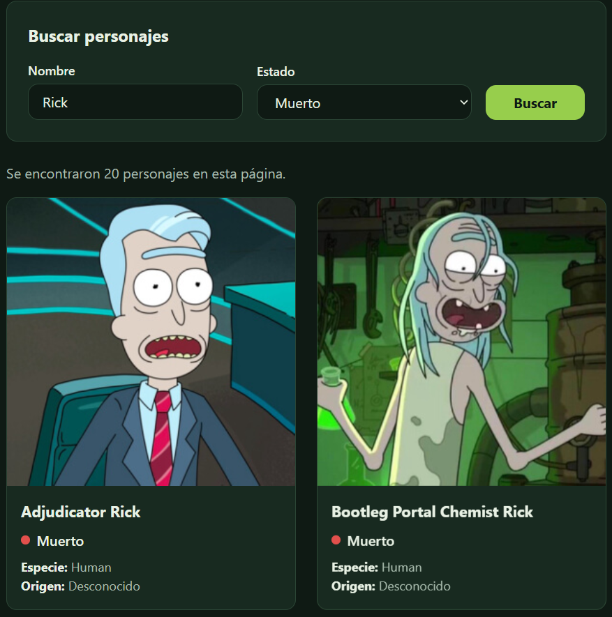

# Buscador Multiversal · Rick and Morty

**Autor:** Ricardo Moreira Correa
**Variante:** A · Personajes (endpoint `https://rickandmortyapi.com/api/character`)
**Página publicada:** https://GreenGapple.github.io/tp-moreira-ricardo/

## Descripción

Página web de una sola pantalla que permite buscar personajes de la serie *Rick and Morty* usando la [Rick and Morty API](https://rickandmortyapi.com/documentation). La búsqueda combina el **nombre** del personaje con su **estado** (Todos, Vivo, Muerto o Desconocido) y muestra los resultados en tarjetas con imagen, nombre, estado, especie y lugar de origen.

## Funcionalidades

- Búsqueda por nombre (`name`) y estado (`status`) en una misma petición, usando `fetch` con `async/await`.
- Tarjetas generadas dinámicamente con `createElement` y `textContent`.
- Los datos vacíos o `unknown` se muestran como «Desconocido».
- Estados de la interfaz: «Buscando…», sin resultados (404) y error de conexión.
- La última búsqueda se guarda en `localStorage` y se repite al recargar la página.
- Diseño responsive con CSS Grid, Flexbox y variables CSS.

## Tecnologías

HTML5 semántico · CSS3 (Grid, Flexbox, variables, media queries) · JavaScript ES6+ · GitHub Pages

## Captura de pantalla

